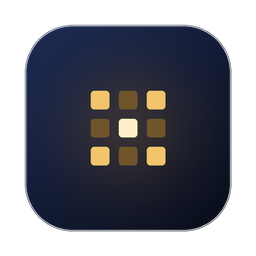

<p align="center"></p>
<h1 align="center">Mirage</h1>
<p align="center">A touchpad-first launcher for Windows, in dark liquid glass.<br>
Apps, files, windows, clipboard, snippets, workspaces, AI, and a local bridge so your AI agents can use Windows too.</p>
<p align="center"><a href="https://hanialnaber.github.io/mirage-launcher/">Website</a> · <a href="https://github.com/hanialnaber/mirage-launcher/releases/latest">Download</a></p>

---

## Install

No admin rights needed.

- **Installer:** download `Mirage-Setup.exe` from [Releases](https://github.com/hanialnaber/mirage-launcher/releases/latest) and run it. It installs just for you, into `%LOCALAPPDATA%\Programs\Mirage`, and adds a Start menu entry.
- **Portable:** download `Mirage-Portable.zip`, unzip it anywhere (even a USB stick) and run `Mirage.exe`. Settings stay in a `data` folder next to it.

Windows 10 (1809+) or Windows 11, 64-bit. The app is self-contained, so you don't need .NET installed.

Windows SmartScreen may warn that the app is from an unknown publisher because the builds aren't code-signed yet. Choose **More info > Run anyway** if you trust the download.

## Use it

Mirage is built to be driven with a touchpad or a mouse, and the keyboard works everywhere too.

**Open it without the keyboard**

- **Hot corner:** push the pointer into the top-left corner of any screen. It waits a quarter of a second so you don't open it by accident, and stays out of the way over full-screen games and videos. Pick the corner and the delay in **Settings > Touchpad & mouse**.
- **Drag to the corner:** drag a file into the hot corner and Mirage opens ready for the drop.
- **Quick menu:** a radial menu opens right at the pointer: Search, Selected text, Ask AI, Clipboard, Quick note, Workspaces, Windows. Open it with a mouse button you choose (middle, back or forward), with **Ctrl+Shift+Space**, or from the tray icon.
- **Touchpad gestures:** Windows keeps three- and four-finger gestures for itself, so apps can't read them. Point them at Mirage instead: open **Settings > Bluetooth & devices > Touchpad > Advanced gestures** (Mirage has a button for it), set a gesture to **Custom shortcut** and record Mirage's keys. Good defaults:

| Gesture | Shortcut | What it does |
|---|---|---|
| Three-finger tap | Alt+Space | Open Mirage |
| Four-finger tap | Ctrl+Shift+Space | Quick menu at the pointer |
| Three-finger swipe up | Ctrl+Alt+Space | Actions for the selected text |

**Inside Mirage**

- **Tiles:** the home screen is big glass tiles that lift as you hover. Click to open, right-click for more actions.
- **Sections:** swipe sideways with two fingers (or press Ctrl+Tab) to move between **Apps**, **Workspaces**, **Clipboard**, **Notes** and **AI**.
- **Drag and drop:** drop files or text onto Mirage to summarize them with AI, send them to an AI chat, add them to a workspace, pin them or show them in their folder. Drop onto a workspace, AI or note tile to act on that tile directly.
- Prefer a compact list? Switch **Home view** to List in settings.

**Or type.** Press **Alt+Space** anywhere, type, press **Enter**.

| Type | What you get |
|---|---|
| anything | Apps, settings pages, system commands, workspaces, snippets, files, then web search and Ask AI |
| `w ` | Switch to an open window |
| `f ` | Find files by name (Windows Search index, with a folder-scan fallback) |
| `c ` | Clipboard history: paste, paste as UPPER/lower/JSON/slug…, ask AI about it |
| `;` | Snippets with placeholders like `{date}`, `{time}`, `{clipboard}` |
| `ws ` | Workspaces: open a whole set of apps, sites and folders at once |
| `?` or `ai ` | Ask ChatGPT, Claude, Perplexity, Grok, Copilot or Gemini |
| `n ` | Jot a quick note. `notes` searches them |
| `>` | Run a command line, or capture its output to the clipboard |
| `=` | Calculator, plus unit conversion like `10 km to mi` or `72 f to c` |
| `gh`, `yt`, `maps`, `tr`, `ip` | Custom commands. Add your own in settings |

**Quick actions on selected text:** select text in any app, then use the three-finger swipe up you mapped, the quick menu's **Selected text**, or **Ctrl+Alt+Space**. Explain, summarize, fix grammar, translate, reply, improve code with your AI, or transform it in place (UPPER, Title, trim, sort, JSON pretty, Base64, URL encode, slug…).

**Keys:** arrows move · Enter open · Tab more actions · Shift+Enter second action · Alt+1…9 open that item · Ctrl+Tab next section · Ctrl+P pin to home · Ctrl+, settings · Esc clear, then close.

**Snippet expansion (opt-in):** turn on *Expand snippets as I type* and keywords like `;date` expand in any app. Typing is never stored or sent anywhere.

## AI agents

Mirage can let AI agents on your PC (Claude Desktop, Cursor, VS Code, custom bots and others) open apps, switch windows, use the clipboard, run your workspaces and more. It's **off by default**.

Turn it on in **Settings > AI agents**. Then:

- It listens on `127.0.0.1` only, never on your network.
- Every request needs your token (`Authorization: Bearer <token>`).
- Requests from web pages are refused (Origin and Host checks), so a website can't reach it.
- Each tool is **Allow**, **Ask** (you approve each call in a prompt; it denies by itself after 60 seconds) or **Deny** (hidden from agents).
- Risky tools start as **Ask**: opening files, window actions, reading the clipboard, pasting, sending keys, file search, running your custom commands, reading notes, locking the PC.

### Connect with MCP (stdio)

For Claude Desktop, Cursor, VS Code and most MCP clients, add this to the client's MCP config (Settings > AI agents has a Copy button with your exact path):

```json
{
  "mcpServers": {
    "mirage": {
      "command": "C:\\Users\\you\\AppData\\Local\\Programs\\Mirage\\Mirage.exe",
      "args": ["--mcp"]
    }
  }
}
```

`Mirage.exe --mcp` is a small proxy that reads your token from your settings and forwards to the running Mirage. Mirage must be running with the bridge on.

### Connect with MCP (HTTP)

For clients that take a URL (Streamable HTTP, JSON responses):

```
URL:     http://127.0.0.1:47821/mcp
Header:  Authorization: Bearer <your token>
```

### REST

```
GET  http://127.0.0.1:47821/health                 (no token needed)
GET  http://127.0.0.1:47821/v1/tools
POST http://127.0.0.1:47821/v1/tools/{name}        JSON body = the tool's arguments
```

```
curl -X POST -H "Authorization: Bearer <token>" -H "Content-Type: application/json" ^
     -d "{\"app\":\"Notepad\"}" http://127.0.0.1:47821/v1/tools/launch_app
```

### Tools

`list_apps` · `launch_app` · `open_url` · `open_path` · `list_windows` · `get_active_window` · `focus_window` · `window_action` (minimize, maximize, restore, close) · `clipboard_read` · `clipboard_write` · `paste_text` · `send_keys` · `search_files` · `list_workspaces` · `run_workspace` · `list_commands` · `run_command` · `add_note` · `read_notes` · `notify` · `show_launcher` · `lock_pc`

Agents can't run arbitrary shell commands, only the custom commands you defined.

## Admin rights

Nothing in Mirage needs admin rights, including the hot corner, the quick-menu mouse button and drag and drop. The only exceptions are actions you choose yourself: **Run as administrator** on an app or command shows the normal Windows UAC prompt. Mirage can't send keys into apps that run as administrator unless Mirage also runs elevated, and the quick-menu mouse button may not respond while one of those apps is in front (Windows rules).

## Your data

Settings, notes, usage counts and the log live in `%APPDATA%\Mirage` (or the portable `data` folder). Clipboard history stays in memory unless you turn on *Remember clipboard history*. Mirage skips clipboard items that password managers mark as private. Nothing is sent anywhere except the web searches and AI chats you open yourself.

## Build from source

Needs the .NET 8 SDK. On Windows:

```
dotnet test tests/Mirage.Tests
dotnet publish src/Mirage.App -c Release -r win-x64 --self-contained true -p:PublishSingleFile=true -p:IncludeNativeLibrariesForSelfExtract=true -p:EnableCompressionInSingleFile=true -o out/publish
```

`build.sh` does the same on Linux (cross-compiling with `EnableWindowsTargeting`) and also builds the NSIS installer and zips.

Project layout:

- `src/Mirage.Core`: pointer and gesture math (corners, radial hit-testing, swipe detection), search ranking, calculator, units, query routing, snippets, notes, settings, and the agent bridge (MCP, REST, stdio proxy). Plain .NET, fully unit-tested.
- `src/Mirage.App`: the WPF app (glass UI, tiles and sections, hot corner, radial menu, drag and drop, hotkeys, clipboard, windows, icons, file search, tray).
- `tests/Mirage.Tests`: xunit tests, including end-to-end tests of the bridge over TCP.
- `installer/`: NSIS per-user installer.
- `docs/`: the website (GitHub Pages).

## License

MIT
